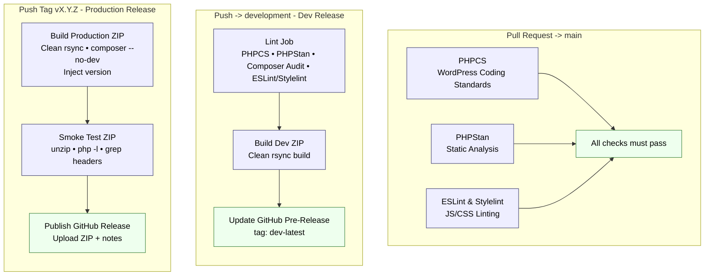

# Availability Calendar for Beds24

A lightweight WordPress plugin that displays a Beds24 room or property availability calendar via the `[avail_calendar]` shortcode.

No jQuery. No build step. No external dependencies beyond the Beds24 availability API.

---

## Features

- **Colour-coded tiles** — green (available), red (unavailable), diagonal split for arrival/departure transition days
- **Locale-aware** — month names, weekday labels, and first day of week adapt automatically to any BCP-47 language tag via the browser's built-in `Intl` API
- **Opens on the first possible arrival** — the first month shown is the month of the first day a guest can arrive (see [Starting month](#starting-month))
- **Click-to-book** — an available date opens the site's `/booking/` page in the page's language (`/en/booking/` with TranslatePress) with `?arrivee=<date>&room_id=<roomid>`, in the same tab; `beds24_booking="true"` links to `beds24.com/booking.php` with the date, room and language instead (new tab, as before 1.8.0)
- **SessionStorage cache** — 5-minute TTL per room/property, avoids repeated API calls during navigation
- **Dark mode** — respects `prefers-color-scheme`
- **Multiple instances** — each shortcode creates an independent `AvailCalendar` class instance; safe to use several times on the same page

## Example of Display


## Elementor Integration


Note that the number of months can be selected independantly for desktop, tablet, and mobile size.


---

## Installation

1. Download or clone this repository
2. Copy the `availability-calendar-for-beds24` folder to your WordPress installation's `/wp-content/plugins/` directory
3. Activate the plugin via **Plugins → Installed Plugins** in WordPress admin

---

## Shortcode Usage

```
[avail_calendar roomid="12345" nummonths="5" lang="fr"]
[avail_calendar propid="67890" nummonths="3" lang="en"]
[avail_calendar roomid="12345" nummonths="3" nummonthstablet="2" nummonthsmobile="1" lang="fr"]
```

### Attributes

| Attribute         | Default              | Description                                         |
|-------------------|----------------------|-----------------------------------------------------|
| `roomid`          | —                    | Beds24 room ID (use `roomid` OR `propid`, not both) |
| `propid`          | —                    | Beds24 property ID                                  |
| `nummonths`       | `5`                  | Months shown on desktop (1–12)                      |
| `nummonthstablet` | same as `nummonths`  | Months shown on tablet, 768–1024 px (1–12)          |
| `nummonthsmobile` | same as `nummonths`  | Months shown on mobile, < 768 px (1–12)             |
| `startmonth`      | see `startfrom`      | Starting month (1–12)                               |
| `startyear`       | see `startfrom`      | Starting year (2020–2100)                           |
| `startfrom`       | `available`          | `available` = month of the first possible arrival; `current` = current month (before 1.9.0). Ignored when `startmonth` or `startyear` is set |
| `lang`            | `en`                 | BCP-47 locale, e.g. `fr`, `de`, `es`, `it`, `nl`    |
| `beds24_booking`  | `false`              | `true` = days link to the Beds24 booking page       |

### Starting month

With `startfrom="available"` (the default), the calendar opens on the month containing the **first day on which an arrival is possible**, from today onwards. With several months displayed, that month is the first of the set.

- "Arrival possible" is what the calendar links to booking: a fully available day, or a split day free from the afternoon (see [Tile Logic](#tile-logic)).
- If the current month has a possible arrival, the calendar opens on the current month.
- If the loaded data has no possible arrival at all, it opens on the current month, with no message.
- ‹ goes back as far as the current month and stops there (the button is disabled), so a guest can see that the earlier months are closed.
- Availability is exactly what Beds24 returns; this only chooses the first month shown.

**Computed in the browser.** The month is chosen in `calendar.js` from the availability the calendar already loads (Beds24 returns every day from yesterday to one year ahead, about 5 KB per room), with no extra request. It is not computed in PHP because cached page HTML (Cloudflare, page caches) would freeze it while bookings change. Until the data has arrived, the months are hidden but keep their space, so the current month never flashes before the switch.

**Never hidden for good (1.10.0).** If the availability call fails (network error, HTTP error, a response that is not a JSON object), the calendar is shown at once on the current month, as with `startfrom="current"`. If Beds24 has not answered after **5 seconds**, it is shown on the current month too; when the data arrives later the days fill in, but the months do not move under the guest. Beds24 normally answers in well under a second (about 0.2–0.5 s measured on 22 Oct 2026), so 5 s only catches a call that is really stuck, while staying short enough that the empty space doesn't look broken.

### Before the data arrives

Availability comes only from Beds24. Until the data has arrived, in both modes, every day from today onwards is drawn like a past day (muted number, no colour), has no booking link and is not clickable (class `bac-pending`). If the call fails, the days stay that way; the 5-minute refresh tries again. The error message is in `.bac-status`, which the `split` navigation (all presets) hides.

### Booking event

When a guest clicks a bookable day, the calendar dispatches a DOM event on its wrapper (`.bac-wrapper`, the shortcode's `<div id="bac-…">`) **synchronously, inside the click, before the browser follows the link**:

```js
document.addEventListener('bac:book', (e) => {
  e.detail.arrival; // 'YYYY-MM-DD' — the day clicked
  e.detail.roomId;  // Beds24 room id (number) of the calendar; null for a propid calendar
});
```

- `CustomEvent` named `bac:book`, `bubbles: true`, not cancelable: the link opens whether anyone listens or not, and nothing changes when nobody does.
- Keep listeners synchronous and quick: when the site's booking page opens in the same tab, the page unloads right after. For analytics, use a transport that survives the unload (Matomo and GA queue with `sendBeacon`).
- The plugin itself sends nothing to any analytics tool.

`startfrom="current"` keeps the behaviour from before 1.9.0: it opens on the current month, and ‹ is not limited. An explicit `startmonth`/`startyear` always opens on that fixed month. Elementor widget: **Display → Open On**.

### Hint line

Under the months the calendar shows « Click an arrival date to book », because the tiles' `title` tooltip (kept for mouse users) never shows on a touch screen. Every bookable day is a link, so the line is always shown.

It is static markup printed by PHP through gettext (`availability-calendar-for-beds24` text domain), not a string inserted by JS, so TranslatePress can translate it like the rest of the page. The plugin ships `languages/availability-calendar-for-beds24.pot` and a French translation (`fr_FR`: « Cliquez sur une date d'arrivée pour réserver »); other languages can be translated in TranslatePress (gettext strings) or with a `.po`/`.mo` file.

Styling: class `.bac-hint`, with the custom properties `--bac-hint-size` (default `13px`), `--bac-hint-color` (default `--cal-text`) and `--bac-hint-align` (default `center`).

### Language detection

When `lang` is omitted, the language is detected in this order: the `lang` attribute → TranslatePress's `$TRP_LANGUAGE` global (current request language) → legacy TranslatePress functions → WordPress locale → `en`.

Month names, weekday labels and the first day of the week use the full locale, region included (1.10.1): TranslatePress's `en_GB` gives `en-GB`, so English weeks start on Monday, like French, German, Spanish and Italian (`en-US` would start on Sunday). The first day comes from the browser's `Intl` week data; browsers without it (Firefox) use the region (Sunday for US, CA, MX, BR, JP, KR, TW, HK, IL, IN, PH; Monday otherwise). An explicit `lang` attribute is used as given (`lang="en"` = en-US, Sunday). The Beds24 booking link keeps the two-letter language.

### TranslatePress

The calendar renders its months already in the page language, so TranslatePress's browser-side ("dynamic") translation must not look them up again as French (before 1.10.1: « Kill » for Tue in English, « Es ist / Also » for Sa / So in German, « Mare » for Mer in Italian). The wrapper and every element `calendar.js` creates carry `data-no-dynamic-translation` (TranslatePress tests `closest()` when its observer runs, and a node removed by a re-render is detached by then, so the wrapper alone is not enough). `data-no-translation` is not used: the months never exist in the server HTML, and on the wrapper it would also stop the server-side translation of the hint and the `aria-label`, which come from gettext.

### Booking link rewriting

Every Beds24 booking link (`beds24.com/booking*.php`) in the front-end page HTML — from any source, not just the calendar — gets its `lang` parameter set to the current page language (two-letter code), replacing an existing value or appending one. Admin, AJAX, REST/JSON, feeds and robots.txt are untouched. Disable with:

```php
add_filter( 'bac_rewrite_booking_links', '__return_false' );
```

The device tier is decided in the visitor's browser from the viewport width, and the calendar re-renders if the window is resized across a tier.

---

## Architecture

```
availability-calendar-for-beds24/
├── availability-calendar-for-beds24.php   ← Plugin entry point, shortcode, footer init
├── assets/
│   ├── calendar.css                       ← Scoped styles (.bac-wrapper)
│   └── calendar.js                        ← AvailCalendar class
├── languages/                             ← .pot template and fr_FR translation
├── tests/                                 ← node:test tests (npm test), not shipped
└── readme.txt                             ← WordPress plugin readme
```

### How it works

1. Each `[avail_calendar]` shortcode renders a `<div id="bac-{unique}">` container and registers its config.
2. A single `<script>` block at `wp_footer` instantiates all `AvailCalendar` instances collected during page render.
3. Each instance fetches availability from `media.xmlcal.com`, caches it in `sessionStorage`, picks the starting month from that data (`startFrom`), and renders the calendar into its own container.
4. CSS and JS are each enqueued once per page regardless of how many shortcodes appear.

### JavaScript class

The `AvailCalendar` class can also be used outside WordPress:

```html
<link rel="stylesheet" href="assets/calendar.css">
<script src="assets/calendar.js"></script>

<div id="my-calendar"></div>
<script>
  new AvailCalendar({
    containerId: 'my-calendar',
    roomid:      12345,
    numMonths:   5,
    startFrom:   'available',   // or 'current'
    lang:        'fr',
  });
</script>
```

---

## Tile Logic

| Today | Yesterday | Result |
|-------|-----------|--------|
| past  | —         | Grey text, no background |
| no data yet | —   | Grey text, no background, not clickable (1.10.0) |
| `0`   | `0` or past | Full red (unavailable) |
| `0`   | `1`         | Green top-left / red bottom-right (AM free, PM taken) |
| `1`   | `1` or absent | Full green (available) |
| `1`   | `0`         | Red top-left / green bottom-right (AM taken, PM free) |

---

## CI/CD Pipeline




---

## Privacy

- Availability data is fetched **directly in the visitor's browser** from `media.xmlcal.com`. No data passes through your WordPress server.
- The Beds24 `roomid`/`propid` is visible in browser network requests and in booking URLs. This is inherent to the Beds24 API and consistent with the official Beds24 widget.
- No personal data is collected. `sessionStorage` cache is cleared automatically when the browser tab is closed.

---

## License

GPLv2 or later © Jacques Leisy

This plugin is free software; you can redistribute it and/or modify it under the terms of the [GNU General Public License v2](https://www.gnu.org/licenses/gpl-2.0.html) or later.
